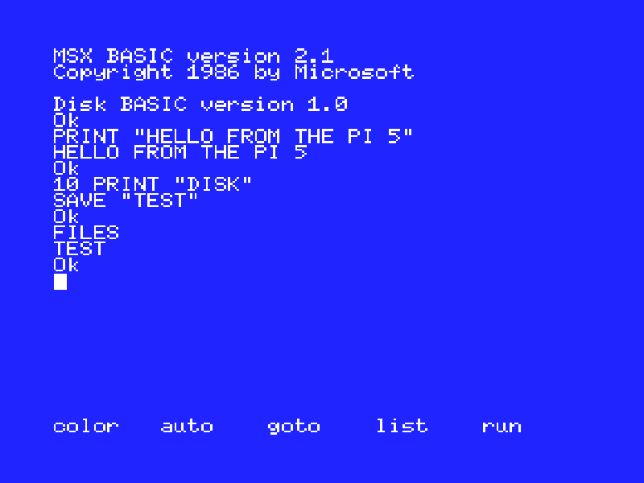
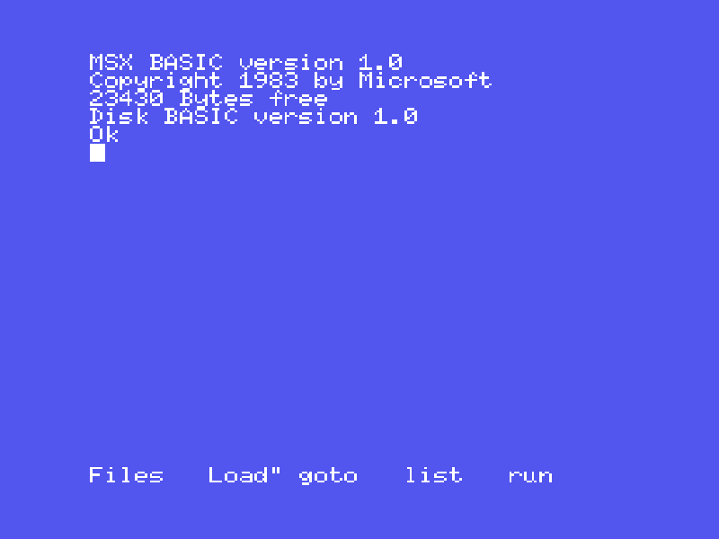
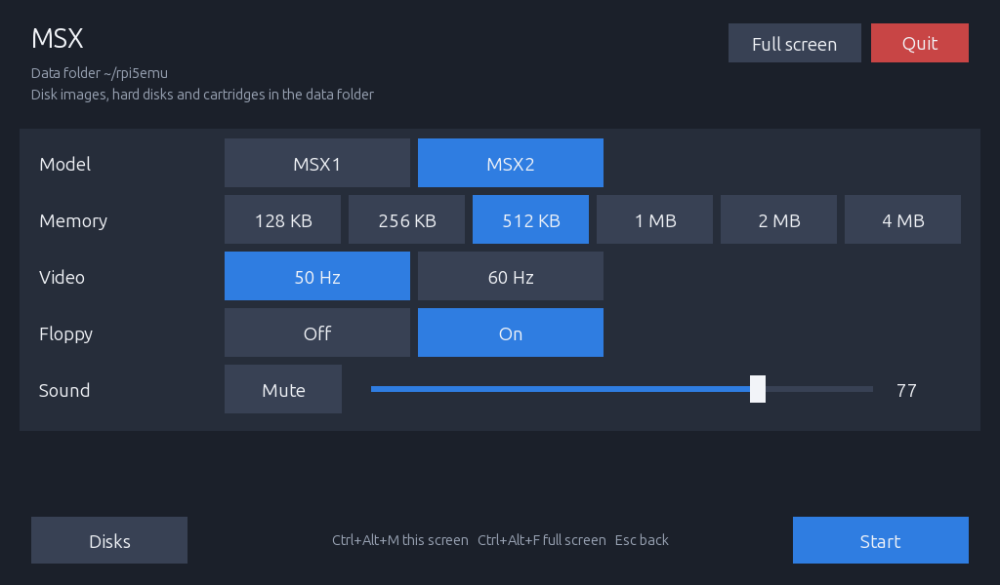
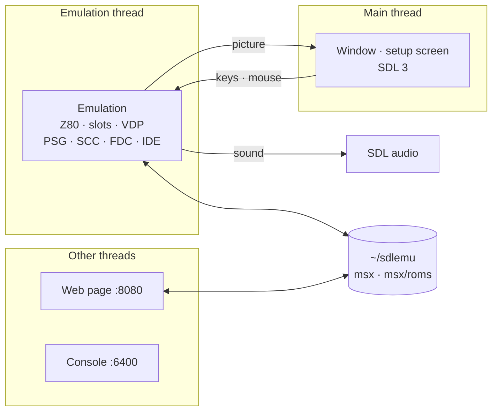

<h1 align="center">sdlmsx</h1>

<p align="center">
  <b>An MSX1 or MSX2 in an SDL 3 window on Linux or macOS.</b><br>
  Z80 with the MSX's wait states, TMS9918A and V9938 with all their modes and commands, AY-3-8910 and SCC sound, floppy drives, a Nextor hard disk, ROM cartridges.
</p>

<p align="center">
  
  
  
  
  
  
</p>

<p align="center">
  <b>Work in progress:</b> not everything has been tested, and games and demos may or may not
  work satisfactorily.
</p>

<p align="center">
  
  
  <br>
  <sub>The MSX2 saving a program to a new disk, and the MSX1, on the Pi.</sub>
</p>

sdlmsx runs [esp32msx](https://github.com/rlucencic/esp32msx)'s MSX on 64-bit Linux (arm64 and amd64) and Apple Silicon macOS. SDL 3 provides the window, sound and input. The machine is the
same code as on the ESP32 boards: esp32msx's platform-independent core and
[esp32emu](https://github.com/rlucencic/esp32emu)'s CPU core, on
[sdlemu](https://github.com/rlucencic/sdlemu), the family's desktop runtime: a setup
screen in the window, sound, the host's keyboard and mouse, a web page on your network and a
console.

It belongs to the SDL desktop family of the ESP32 emulators:
[sdlzx](https://github.com/rlucencic/sdlzx) (ZX Spectrum),
[sdlcpc](https://github.com/rlucencic/sdlcpc) (Amstrad CPC),
[sdlcbm](https://github.com/rlucencic/sdlcbm) (Commodore 64 and 128),
[sdlcoco](https://github.com/rlucencic/sdlcoco) (Tandy Color Computer 2 and 3),
[sdlgs](https://github.com/rlucencic/sdlgs) (Apple IIGS),
[sdlxl](https://github.com/rlucencic/sdlxl) (Atari 800XL and 130XE),
[sdlste](https://github.com/rlucencic/sdlste) (Atari STE),
[sdlpc](https://github.com/rlucencic/sdlpc) (IBM PC/XT and PC/AT),
[sdlmac](https://github.com/rlucencic/sdlmac) (Macintosh Plus, SE, Classic),
[sdlmac2](https://github.com/rlucencic/sdlmac2) (Macintosh LC and II),
[sdlmac3](https://github.com/rlucencic/sdlmac3) (Macintosh LC II and LC III),
[sdlarc](https://github.com/rlucencic/sdlarc) (Acorn Archimedes),
[sdlami](https://github.com/rlucencic/sdlami) (Amiga 500, 2000, 600, 1200).

## Features

**The machines**
- **MSX1** (64 KB, TMS9918A, or TMS9929A at 50 Hz) and **MSX2** (a memory
  mapper of 128 KB to 4 MB; V9938 with 128 KB of VRAM,
  RP5C01 clock), chosen on the setup screen with **50 or 60 Hz** video
- **Z80** at 3.58 MHz on the shared core, with the wait state the MSX engine
  adds to every M1 cycle
- **Slots and subslots** as an MSX lays them out: BIOS and BASIC, the
  cartridge, the memory mapper, the MSX2's SUB-ROM, the disk ROM, Nextor
- **TMS9918A / V9938**: text 40 and 80 columns (with blink), the graphic
  modes G1 to G7, multicolour, sprite modes 1 and 2 (eight a line, a colour
  per line), the 512-colour palette, vertical scroll, line interrupts and all
  the V9938's commands (lines, fills, block moves, logical operations)
- **Sound**: the AY-3-8910's three channels and noise, the key click, and
  Konami's SCC in SCC cartridges
- **Keyboard** by position (international layout), **joystick** on the
  numeric keypad or the cursor keys

**Drives**
- **Two floppy drives** behind a WD2793, as Philips built the disk interface:
  `.dsk` images (720 KB and 360 KB), read and written in place, new
  formatted disks on request. **Floppy Off** leaves the disk interface out,
  as on an MSX without drives: BASIC starts at once and, without a hard
  disk, has 28815 bytes free instead of 23430 (the disk ROM keeps its work
  area at the top of RAM), which some cassette-era programs need. A Nextor
  hard disk works either way
- **A hard disk** on a Sunrise IDE interface with **Nextor**: a raw image of
  any size, read and written in place; new ones come with a FAT16 partition
  (32 or 128 MB). With a hard disk in, Nextor starts first: the hard disk is
  A: and the floppies B: and C:, as on an MSX with a Nextor cartridge
- **ROM cartridges**: plain ROMs up to 64 KB and MegaROMs (ASCII 8, ASCII
  16, Konami, Konami SCC), the mapper found from the code

**Around it**
- **A window** of its own on the Pi's desktop (X11 or Wayland), resizable, full screen
  with Ctrl+Alt+F; the picture in the machine's shape, sharp pixels
- **Setup screen** in the window, first thing at start and any time with Ctrl+Alt+M:
  model, memory, video, floppy, the sound's volume, the drives and their images (insert, eject, new
  blank ones), Start / Back / Restart, Reset
- **The Pi's keyboard and mouse**: keys by position, as the boards' Bluetooth keyboards;
  a click in the window gives the mouse to the machine, Ctrl+Alt+G takes it back
- **Web page** at `http://<the Pi>:8080/`: drop images (or ZIP files) onto it, insert
  them, make blank ones, and watch the machine and its drives live
- **Sound** through SDL (PipeWire, PulseAudio or ALSA), the machine paced by the clock
- **Console** on the terminal and on `127.0.0.1:6400`: keys, typing, drives, screenshots

<p align="center">
  
  <br><sub>The setup screen in the window, before the MSX starts</sub>
</p>

## Getting started

### 1. What you need

- 64-bit Linux (including Raspberry Pi 5) or Apple Silicon macOS with SDL 3.2 or newer. See [desktop build dependencies](https://github.com/rlucencic/sdlemu#building).
- [esp32emu](https://github.com/rlucencic/esp32emu), [sdlemu](https://github.com/rlucencic/sdlemu)
  and [esp32msx](https://github.com/rlucencic/esp32msx), cloned next to this project
- The ROMs (below)

### 2. Build

```sh
git clone https://github.com/rlucencic/esp32emu.git
git clone https://github.com/rlucencic/sdlemu.git
git clone https://github.com/rlucencic/esp32msx.git
git clone https://github.com/rlucencic/sdlmsx.git && cd sdlmsx
cmake -S . -B build -G Ninja && cmake --build build
```

### 3. ROMs

In the data folder's `msx/roms/` (`~/sdlemu/msx/roms`), named as esp32msx's:
`msx.rom` (MSX1), `msx2.rom` and `msx2ext.rom` (MSX2), `disk.rom` (Disk
BASIC), `nextor.rom` (Nextor for the hard disk). Not part of this
repository.

### 4. First start

1. `build/sdlmsx`: the setup screen opens in a window.
2. Choose the model and click **Start**.
3. Put images into `~/sdlemu/msx/`, drop them on the window or the web page, and
   insert them on the setup screen's **Disks** page.

## Using it

| To | Do |
|---|---|
| Get back to the setup screen | Ctrl+Alt+M (the machine waits meanwhile) |
| Full screen | Ctrl+Alt+F |
| Give the mouse to the machine, take it back | A click in the window; Ctrl+Alt+G |
| Run as fast as it goes (warp) | Ctrl+Alt+W, again for real speed |
| Take a screenshot | Ctrl+Alt+S (into `~/sdlemu/screenshots`), or the console's `s` |
| Insert an image | The setup screen's **Disks** page, drop it on the window or the web page, or name it on the command line: `build/sdlmsx game.rom` |
| Start straight into the machine | `build/sdlmsx -S`, with the setup screen's rows as `--choice`: `build/sdlmsx -S --choice Model=MSX1` |
| Show the window on another computer | Log in with `ssh -C -Y <the Pi>` and start it there: fine for still pictures; games want the Pi's own monitor |
| Load or save a program | `SAVE"A:NAME.BAS"`, `LOAD"A:NAME.BAS"`, `FILES` |

Images live in `~/sdlemu/msx/`, settings in `~/.config/sdlemu/settings.ini`; the
inserted images are remembered across starts. `build/sdlmsx --help` lists the options.

**Keyboard**: by position, the international MSX layout on a US keyboard:
Ctrl, Shift and Caps Lock as themselves, left Alt GRAPH, right Alt CODE,
F1-F5 as themselves and F6-F10 as SHIFT with F1-F5, Home CLS/HOME, Insert
INS, Delete DEL, End or Pause STOP, Page Up SELECT.

**Joystick**: the numeric keypad (8 4 6 2 and the diagonals, 0 or 5 trigger
A, `.` trigger B) in port 1; F11 switches it to port 2. F12 makes the cursor
keys the joystick too (Alt trigger A, AltGr trigger B).

## How it works



- **[esp32msx](https://github.com/rlucencic/esp32msx)'s `components/msx`**: the MSX,
  platform independent: the same code runs on the ESP32 boards.
- **`src/`**: the glue, esp32msx's `main/main.c` ported: memory, ROMs, settings, keyboard map,
  drives and status.
- **[sdlemu](https://github.com/rlucencic/sdlemu)**: the window, the setup screen, sound,
  input, the web page, the console, the data folder and the settings.
- **[esp32emu](https://github.com/rlucencic/esp32emu)**: the CPU core (Z80).

## Development

```sh
../sdlemu/tools/pi.sh sdlmsx build        # from another computer: sync to the Pi, build there
../sdlemu/tools/pi.sh sdlmsx run          # its window on this computer (ssh -C -Y)
../sdlemu/tools/pi.sh sdlmsx headless     # no window: drive it through the console
../sdlemu/tools/console.sh i 's /tmp/shot.png'
```

`CLAUDE.md` has the details: the layout, how it was ported, the checks; esp32msx's own
`CLAUDE.md` has the machine's.

## Limitations

- Checked on the Pi through its console and screenshots: the MSX2 at full speed, BASIC, a program saved to a new disk and FILES; the MSX1. Not yet by hand
  in the window, with the sound heard, or with much software.
- Over X forwarding (`ssh -Y`) every changed picture crosses the network: 8 to 15 a second.
- Tested so far with MSX1 and MSX2 BASIC, the screen modes, sprites and the
  V9938's commands, floppies, Nextor on a hard disk, and test cartridges for
  each mapper and the SCC; **games haven't been tried yet**.
- No cassette, printer, MSX-MUSIC (FM-PAC) or MSX-AUDIO; no MSX2+ or turbo R;
  `.dsk` images only (no `.dmk`); one hard disk; cartridges in one slot.
- Floppies are quicker than a real drive: a sector is there as soon as it's
  asked for.

## Credits

- [openMSX](https://openmsx.org): the reference for the Sunrise IDE and many
  details of the machines
- [fMSX](https://fms.komkon.org/fMSX/) by Marat Fayzullin: the way to tell
  MegaROM mappers apart
- [Nextor](https://github.com/Konamiman/Nextor) by Konamiman
- [SDL](https://libsdl.org) 3 for the window, the sound and the input

## Licence

[MIT](LICENSE).

MSX is a trademark of MSX Licensing Corporation. The ROM images are not part
of this repository.
